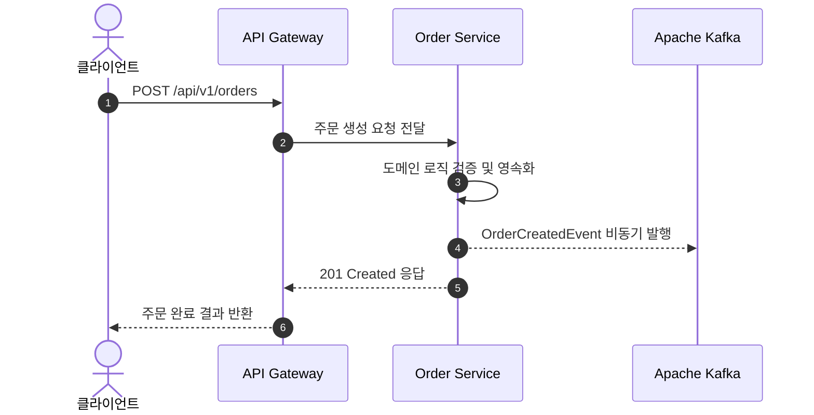

기존 Jekyll(Chirpy 테마)에서 루비 의존성을 덜어내고 빌드 속도와 마크다운 확장성이 뛰어난 **AstroPaper**로 블로그를 이전했습니다.

## Table of contents

## 1. GitHub 스타일 알림 상자 (Callouts)

`rehype-callouts` 플러그인이 기본 내장되어 있어 GitHub 표준 문법으로 알림 상자를 사용할 수 있습니다.

> [!NOTE]
> 아키텍처 설계 및 트러블슈팅 기록을 정리하는 공간입니다.

> [!TIP]
> 우측 상단의 테마 토글 버튼을 눌러 라이트/다크 모드 전환을 확인해 보세요.

> [!WARNING]
> 프로덕션 배포 전 설정 파일(`astro-paper.config.ts`)의 도메인 주소를 반드시 확인하세요.

## 2. Mermaid 다이어그램 렌더링 테스트

별도의 단축 코드(Shortcode) 없이 표준 `mermaid` 코드 블록을 그대로 사용하며, 다크 모드 전환 시 테마도 자동으로 동기화됩니다.



## 3. 코드 블록 파일명 탭 및 라인 하이라이팅

코드 블록 첫 줄에 `file="파일명"`을 적으면 상단에 파일명 탭이 생성되고, 주석으로 특정 줄을 강조하거나 Diff 표시를 넣을 수 있습니다.

```java file="OrderApplicationService.java"
@Service
@RequiredArgsConstructor
public class OrderApplicationService {
private final OrderRepository orderRepository;
    private final ApplicationEventPublisher eventPublisher;

    @Transactional
    public OrderResponse createOrder(CreateOrderCommand command) {
        Order order = Order.create(command); // [!code highlight]
        orderRepository.save(order);

        // 트랜잭션 커밋 후 이벤트 발행을 위한 등록
        eventPublisher.publishEvent(OrderCreatedEvent.from(order)); // [!code ++]
        return OrderResponse.from(order);
    }
}
```
